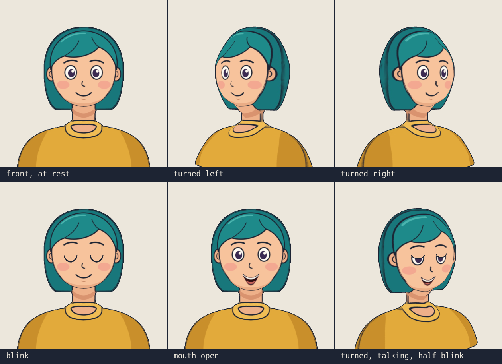

# talking-head

One illustrated portrait in, a small 3D head and shoulders for a web page out. The head follows the pointer, blinks, and moves its jaw with a voice.

You give it a picture. It gets a rough 3D shape for that picture, lines the shape up with the drawing, projects the drawing onto it as the texture, adds a `jaw` morph target, and exports a GLB (about 0.7 MB in the example) plus a small JSON file that says where the eyes and mouth sit. A framework-free three.js module (`viewer/viewer.js`) shows the result.

It is packaged as a [Claude Code](https://claude.com/claude-code) skill (`SKILL.md` tells the assistant how to use it), and it also works by hand from the command line.



The example character, Juno, is an original drawing made for this repository (`examples/juno/portrait.svg`). She is not a real person.

## What it makes

- `head.glb`: one mesh, one JPEG texture, one morph target called `jaw`. Unlit: the drawing already carries its own light and shade.
- `head.json`: where the eyes and mouth are on the surface (with a small grid of depths around each, so eyelids and the open mouth follow the curve of the head), the drawn line between the lips, how far the jaw drops, colours for the eyelids, lashes and lower lip taken from the picture, and the width and colour of the drawing's outline.
- `preview.png`: a contact sheet of six poses, drawn by the real viewer in headless Chrome, so you can look before you ship.
- In the page: pointer follow, blinking, a jaw driven by a loudness function (or a speech-like rhythm when there is no sound to follow), the drawing's outline redrawn around the head so it survives turning, no drawing while off screen, `prefers-reduced-motion` respected, and a `dispose()` that frees everything.

## Limits

Read these before you plan around it.

- **It works best on front-facing illustrated portraits**: a cartoon or drawn head and shoulders, looking at the viewer, on a transparent or flat-coloured background. Photos, three-quarter views, hands in front of the face, glasses and long fringes over the eyes all give poor results.
- **It is not a face-capture, lip-sync or deepfake tool.** The jaw opens and closes with loudness. There are no visemes, no expressions, no eye movement, and nothing is learned from video of a person.
- **Get consent before using a picture of a real person**, including a drawn likeness. Do not use it to impersonate anyone.
- **With `--source space` the picture is uploaded to a third party**: Hugging Face (huggingface.co), to a public Space run by Tencent. It only happens with `--yes-upload` or a typed `yes`, after a message naming Hugging Face, the Space and the licence's territory limit. Only the picture is sent, as `input.png`, and anonymously: `gradio_client` would otherwise attach a Hugging Face login saved on your machine, so the request is made with `token=False` and `HF_HUB_DISABLE_IMPLICIT_TOKEN=1`. Nothing is sent at all with `--source inflate` or `--mesh`, and `head check` only contacts huggingface.co with `--online`.
- **Say that the character is computer-generated.** A talking head that speaks to visitors should be labelled as computer-generated wherever it appears, whichever shape source made it. When the shape came from the public generator, its licence requires that anyway (see below).
- **The picture only covers the front.** Past roughly 35 to 40 degrees of turn you see surfaces the drawing never showed. They get plain colour carried over from the nearest part of the drawing (hair stays hair-coloured, skin stays skin-coloured), with no detail. The viewer turns at most 0.6 radians (34 degrees) by default for this reason.
- **Line work stretches at the sides.** Where the surface turns away, the projected drawing is stretched, so outlines near the edge smear into streaks when the head is turned.
- **Eyelids and the open mouth are drawn on top, not modelled.** The eyelid is a skin-coloured patch, curved to the surface, with a lash line. The open mouth is drawn by a small fragment shader on a patch seated on the face: the opening starts on the drawing's own lip line (found in the picture by the build), its corners stay pinned to the line's ends, and only its lower edge drops, showing a shaded inside, a tooth edge, a tongue, a thin lower line and a soft lower-lip rim. This suits flat cartoon styles. On a painterly drawing it will look simpler than the rest, and when no lip line is found (an open-mouthed drawing, a very faint line) it opens from a straight line across the marked mouth instead.
- **The jaw and the drawn mouth are separate.** The `jaw` morph target moves the chin and the skin below the lip; the opening is drawn over it. At full opening the drawing's own lower lip and any crease under it are covered by the drawn mouth.
- **The texture is never sharper than the picture.** The face is laid out in the texture exactly as it is in the picture, so it keeps the picture's sharpness, but nothing can add detail that is not there. Start from a picture at least 1000 pixels on its longer side. If your source is a vector drawing, export it large.
- **`--source inflate` knows nothing about faces.** It blows the outline up like a balloon and adds a bump for the nose. There are no eye sockets, lips, ears or separate hair volume. It is the offline fallback. A generated or hand-made mesh gives a much better profile.
- **Hidden parts are guessed.** Areas hidden in the drawing (under the chin, inside a collar) take a plain colour from nearby. The build leaves line work out of that colour, to avoid the dark stripes that outlines otherwise cause there. This has only been tested on the inflated example, where little is hidden.
- **The automatic marks are a guess** from typical proportions and what is drawn nearby. Always look at the preview, and fix them on the marking page when they are off.
- **Tested on Linux only**, with Blender 5.3, Chrome and Node 24. The public-generator path could not be run to the end while making this release (see "What was and was not tested").

## Requirements

| Needed | Why | Licence |
|---|---|---|
| Python 3.9 or newer | runs the `head` command (standard library only) | PSF |
| [Blender](https://www.blender.org/) 4.2 or newer | cleans the mesh, bakes the texture, exports the GLB. Run as a separate program, headless | GPL-2.0-or-later |
| [three.js](https://threejs.org/) r160 or newer | the viewer's peer dependency | MIT |
| Google Chrome or Chromium (optional) | draws the preview sheet | Chrome: proprietary freeware. Chromium: BSD-style and others |
| Node.js 18 or newer (optional) | runs the viewer's unit tests | MIT |
| [gradio_client](https://pypi.org/project/gradio-client/) (optional) | only for `--source space` | Apache-2.0 |

None of these is included in this repository. You install them yourself, and their licences apply to your use of them. About 1 GB of free memory is enough. No GPU is needed.

### Licence notes

Checked on 21 November 2026. Check again before you rely on them. This is not legal advice.

- **talking-head's own code and the example character** are under the **MIT License** (see `LICENSE`).
- **Blender** is GPL-2.0-or-later. talking-head runs it as a separate program and does not include or link any Blender code. The scripts in `pipeline/blender/` call Blender's Python API (`bpy`) and are offered under MIT here. **Could not verify** (the Blender Foundation's licence page refused the request while this was written, so this is from memory): the Foundation's position is that what you create with Blender is yours, and that published scripts which call its Python API must be under a GPL-compatible licence. MIT is generally regarded as GPL-compatible. Read https://www.blender.org/about/license/ yourself if this matters to you.
- **three.js** is MIT.
- **The public generator** (`--source space`) is the Hugging Face Space [`tencent/Hunyuan3D-2`](https://huggingface.co/spaces/tencent/Hunyuan3D-2), running the model [`tencent/Hunyuan3D-2`](https://huggingface.co/tencent/Hunyuan3D-2). Both carry the **Tencent Hunyuan 3D 2.0 Community License Agreement** (the model card says `license: other`, `license_name: tencent-hunyuan-community`; the `LICENSE` files in the model and Space repositories were read in full). What it says, as read on that date:
  - **It does not apply in the European Union, the United Kingdom or South Korea.** The licence is limited to a "Territory" defined as the rest of the world, and section 5(c) says you must not use, reproduce, modify, distribute or display the model *or its Output* outside that Territory. If you or your site's visitors are in those places, do not use this source.
  - **Outputs:** "Tencent claims no rights in Outputs You generate. You and Your users are solely responsible for Outputs and their subsequent uses." (section 6(d)).
  - **Commercial use is not forbidden in general.** Section 4 ("Additional commercial terms") requires a separate licence from Tencent if your products or services had more than 1 million monthly active users in the preceding calendar month.
  - You must not use Outputs to improve any other AI model (section 5(b)).
  - The Acceptable Use Policy (Exhibit A) forbids, among other things, impersonating a person without consent, and placing generated content in any public context "without expressly and conspicuously identifying that the information and/or content is machine generated". If you publish a head whose shape came from this model, say so.
  - **Could not verify:** whether using the hosted Space through its API adds terms beyond this licence and Hugging Face's own terms of service; what the Space does with uploaded pictures (retention, logging, reuse); and whether the copy of the licence in the Space repository (which names an older Tencent entity) or the newer copy in the model repository governs the Space. Treat uploads as public.
  - The Space is a free shared demo on Hugging Face ZeroGPU. Anonymous use has a small quota and requests are refused when it is used up. `head shape` asks once and never retries.
- **Any other mesh you bring** (`--mesh`) comes with the terms of whatever made it.
- **The example voice** (`examples/juno/voice.mp3`) was made on the author's machine with the [Kokoro](https://huggingface.co/hexgrad/Kokoro-82M) text-to-speech model (tagged Apache-2.0 on its model card). It is not a recording of a person.

## Install

```bash
# 1. the skill itself (for Claude Code; any folder works if you only use the command line)
git clone https://github.com/VinVirtual/talking-head ~/.claude/skills/talking-head
cd ~/.claude/skills/talking-head

# 2. Blender 4.2 or newer, any way you like, for example:
sudo snap install blender --classic

# 3. three.js for the preview and example pages (your own site uses its own copy)
npm install

# 4. only if you want the public generator
python3 -m pip install gradio_client

# 5. check
./head check
```

Everything is found in default places that you can change with environment variables:

| Variable | Default | What |
|---|---|---|
| `HEAD_BLENDER` | `blender` on PATH, then `/snap/bin/blender` and other usual places | the Blender program |
| `HEAD_CHROME` | `google-chrome`, `chromium` and similar on PATH | browser for the preview sheet |
| `HEAD_THREE` | `node_modules/three` in the skill folder, then in the current folder | three.js for the local pages (`preview`, `mark --page`, `serve`, `test --browser`). Nothing is loaded from a CDN: without it those commands stop and say to run `npm install` |
| `HEAD_PYTHON` | the Python running `head` | Python that has `gradio_client` |

## Quick start

```bash
H=~/.claude/skills/talking-head/head
$H new my-head portrait.png        # a project folder: portrait.png, config.json
$H shape my-head --source inflate  # a shape made on this machine. Or: --mesh your.glb   or: --source space --yes-upload
$H mark my-head --auto             # estimate eyes, mouth, chin. Then check: $H mark my-head --page
$H build my-head                   # out/head.glb and out/head.json
$H preview my-head                 # out/preview.png. Look at it.
$H verify my-head                  # loads, has the jaw, fits the size budget, JSON complete
```

Then in your page (with three.js available to your bundler or import map):

```js
import { createTalkingHead, audioLevel } from './talking-head/viewer/viewer.js';

const head = createTalkingHead(document.querySelector('canvas'), { model: '/head.glb', surface: '/head.json' });
await head.ready;

const audio = document.querySelector('audio');
let voice;
button.addEventListener('click', () => {
  voice ??= audioLevel(audio);              // first call must come from a click or key press; null if it cannot listen
  voice?.resume();
  audio.play();
  head.setTalking(true, voice?.level);      // no level: a speech-like rhythm instead
});
audio.addEventListener('ended', () => head.setTalking(false));
```

Copy `viewer/viewer.js` and `viewer/math.js` into your project (two files, about 35 KB together before minifying, most of it comments). Give the canvas a size with CSS; a square works best.

About the voice: `audioLevel` routes the element's sound through a Web Audio analyser and on to the speakers. A file from another origin can only be analysed when it is fetched with CORS (`crossorigin="anonymous"` on the element and `Access-Control-Allow-Origin` on the file). Without that, analysing it would mute it, so `audioLevel` returns `null`, warns in the console and leaves the element playing normally; pass no level and the mouth follows a speech-like rhythm. An element can be connected to Web Audio only once in its life, so after `close()` use a new `<audio>` element.

`dispose()` leaves the canvas usable, so a component can mount again on the same canvas (React StrictMode, hot reloading). Pass `releaseContext: true` to also force the WebGL context to be lost when you will not use that canvas again.

### The finished example

```bash
$H serve            # then open http://127.0.0.1:8437/examples/  (needs npm install in the skill folder)
```

`examples/juno/` is a complete project folder (`head verify examples/juno` passes): the SVG she was drawn as, the rasterised `portrait.png`, `config.json`, `marks.json` (the automatic estimate, checked by eye against the picture and the preview), `out/head.glb`, `out/head.json`, `out/preview.png`, and a short voice line. The example page uses the fonts already on the visitor's machine and makes no request to any other site. Her shape is the inflated one (`--source inflate`): the public generator refused the request made for this release, so she has a puffy profile with a nose bump and no modelled ears or hair volume. To rebuild her from the portrait:

```bash
$H new juno examples/juno/portrait.png
$H mark juno --set examples/juno/marks.json
$H shape juno --source inflate && $H build juno && $H preview juno
```

## Commands

| Command | What it does |
|---|---|
| `head check` | checks Python, Blender and its version, node, Chrome, three.js and `gradio_client`, without using the network. `--online` also asks huggingface.co whether the public generator is running |
| `head new <project> <portrait>` | starts a project folder from a PNG or JPEG. Pictures with an EXIF orientation tag are refused: rotate them upright and save without the tag, so Blender and the marking page see the same pixels |
| `head shape <project>` | gets the raw shape into `work/`. `--source inflate` builds one from the outline on this machine. `--mesh FILE` uses a mesh you already have from any tool (GLB, glTF, OBJ, PLY, STL). `--source space --yes-upload` uploads the picture to the public Hunyuan3D-2 Space on Hugging Face (`--space` picks another Space with the same interface, `--seed N`); without `--yes-upload` it asks, and from a script it refuses. You must choose a source: nothing is uploaded by default. An existing shape is only replaced after the new one has arrived |
| `head mark <project>` | with nothing else, prints and checks the marks. `--auto` estimates them (`--force` to replace). `--page` serves a page on this machine where you drag ovals onto the eyes and mouth and press Save (the neck is only saved if you move it; otherwise the build finds it). `--set FILE` copies a marks file in |
| `head build <project>` | clean, fit, texture, jaw, feature spots, export. Options: `--faces N` (default 24000), `--texture 512\|1024\|2048\|4096`, `--budget KB` (default 1500), `--front -y\|+y\|-x\|+x` and `--up +z\|+y\|…` for a mesh that faces or stands another way, `--no-remesh`. If the file is over budget it lowers JPEG quality, then texture size, then face count, and says what it did. Exits non-zero if it still does not fit |
| `head preview <project>` | draws `out/preview.png` with the real viewer in headless Chrome: front, turned left, turned right, blink, mouth open, turned while talking. `--tile N` sets the size of each picture |
| `head verify <project>` | checks the GLB parses, has exactly one mesh, the `jaw` target and one texture, is within the budget, and that the JSON is complete |
| `head serve [project]` | serves the skill folder (and a project at `/project/`) on 127.0.0.1 for the example page. It answers only requests addressed to 127.0.0.1, localhost or [::1] on its port, never serves dot-files, and accepts saves only as JSON carrying a token made for that run |
| `head test` | runs the unit tests (`python -m unittest` and `node --test`, no extra packages; the Python tests also run under pytest). `--browser` also runs the viewer in headless Chrome (remounting on one canvas, disposing while loading, junk loudness values, `audioLevel`). `HEAD_BLENDER_TESTS=1` adds a full Blender build that feeds the example's own `head.glb` back in |

`shape`, `mark` and `build` take `--verbose` to show everything Blender prints. Each Blender run's full output is kept in `work/blender-<task>.log`.

`references/formats.md` describes `config.json`, `marks.json`, `head.json` and the viewer's options.

## How it works

1. **Shape** (`pipeline/generate_space.py`, `pipeline/blender/inflate.py`): a raw, untextured mesh of the figure. From the public generator, from your own file, or inflated from the outline.
2. **Mark** (`pipeline/blender/job.py`): where the eyes, mouth, chin and neck are in the picture, in pixels. Estimated, then corrected by you.
3. **Build** (`pipeline/blender/build.py`), in headless Blender:
   - the mesh is turned to face the front, any flat backing plate a generator left behind the figure is removed, and the surface is rebuilt from its volume;
   - its front outline is fitted to the figure's outline, the head and the body separately, and the mesh is moved into the picture's own space, so from the front it lines up with the drawing;
   - the picture is projected on from the front. Points the picture cannot see take a plain colour spread along the surface from the nearest points it can;
   - the texture is baked. Faces the picture covers are laid out exactly as in the picture, in one piece;
   - points between the mouth and the chin get a `jaw` morph target, strongest at the chin;
   - the depth of the surface around each eye and the mouth is sampled, the line between the lips is traced from the drawing's line work, and the eyelid, lash, lip and outline colours are read from the picture.
4. **View** (`viewer/viewer.js`): three.js loads the GLB, shows it unlit, drapes eyelids over the eyes and seats a shader-drawn mouth on the lip line using the depths from the JSON, and animates.

## What was and was not tested

- The whole pipeline was run on the example with `--source inflate`, and with the same shape exported as an OBJ facing backwards (`--mesh`, `--front +y`), with a flat plate added behind it, from a JPEG with a flat background, and with a tight size budget. The preview sheets were looked at.
- The viewer and the example page were run in headless Chrome (software WebGL) at desktop and phone widths, with the voice playing.
- **Not tested:** a mesh that really came from the public generator. The Space refused the one request made while building this release ("exceeded your ZeroGPU runs limit"), so the example uses the inflated shape. The request code is the same call that produced the original head this skill was generalised from, but in this repository it has only been run as far as that refusal.
- **Not tested:** macOS, Windows, Firefox, Safari, real GPUs, phones.

## Development

```bash
./head test                       # 79 Python tests and 26 JavaScript tests
./head test --browser             # plus 5 viewer tests in headless Chrome
HEAD_BLENDER_TESTS=1 ./head test  # plus a full Blender build (about a minute)
./head build <project> --verbose  # everything Blender says
./head preview <project>          # then look at the PNG
```

The maths that can be tested without Blender or a browser lives in `pipeline/headmath.py` and `viewer/math.js`. The Blender steps use `headmath.py` directly, so what the tests check is what runs.
